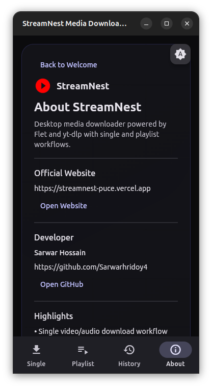
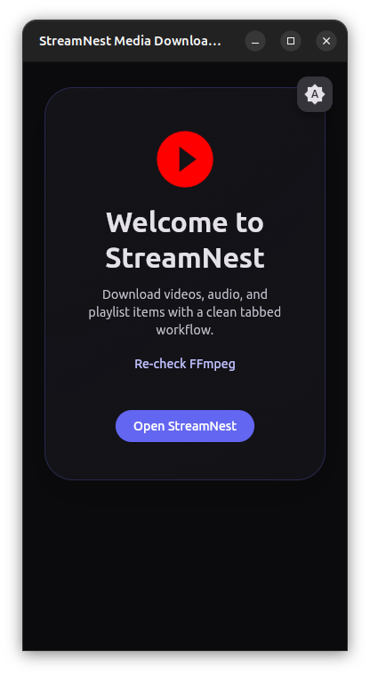
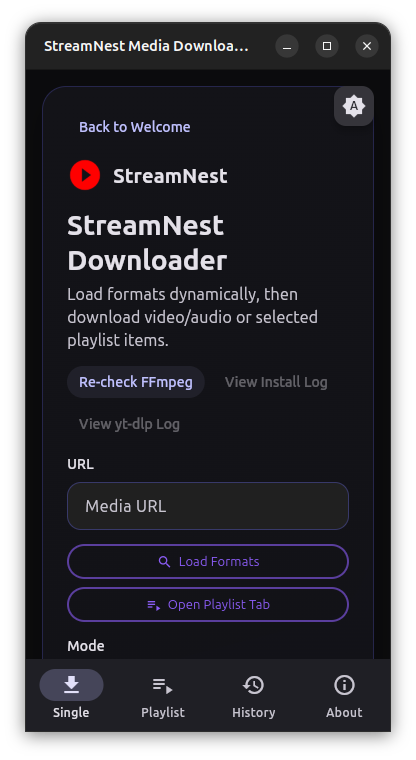
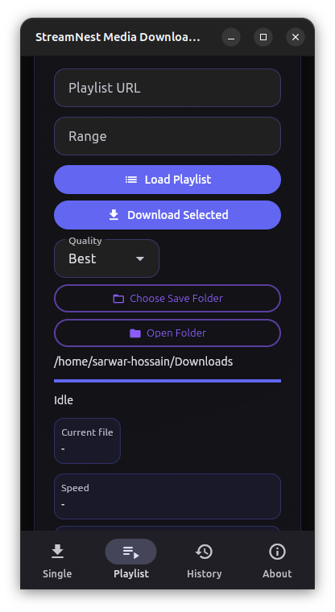
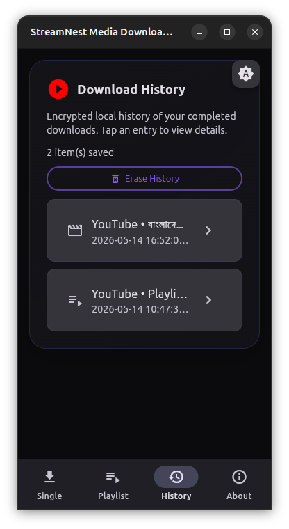
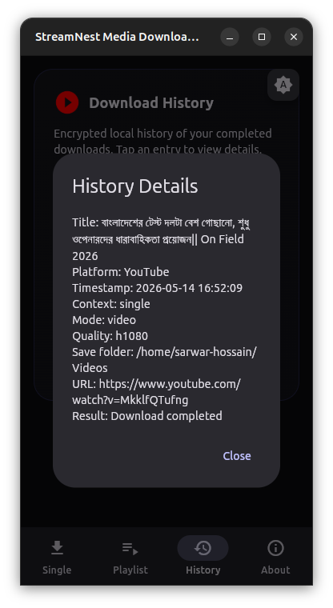
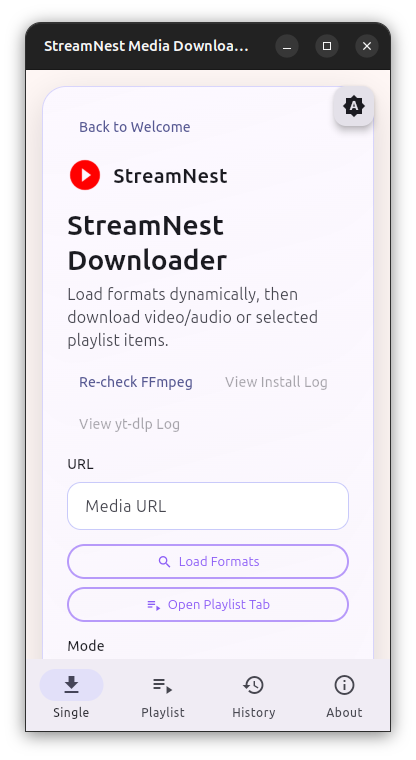
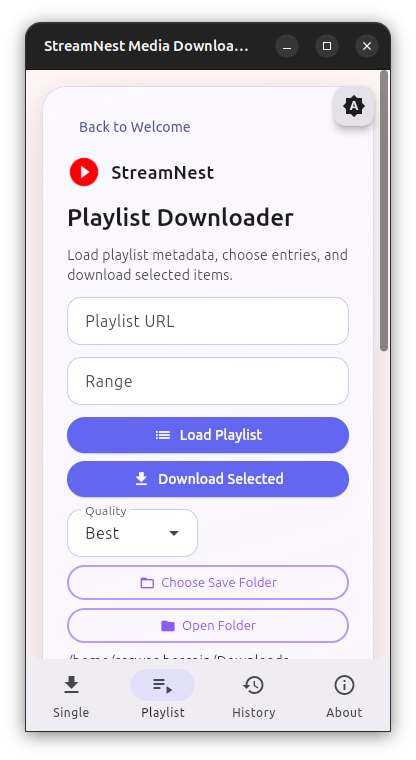
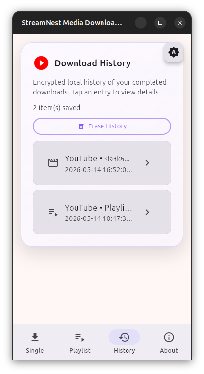
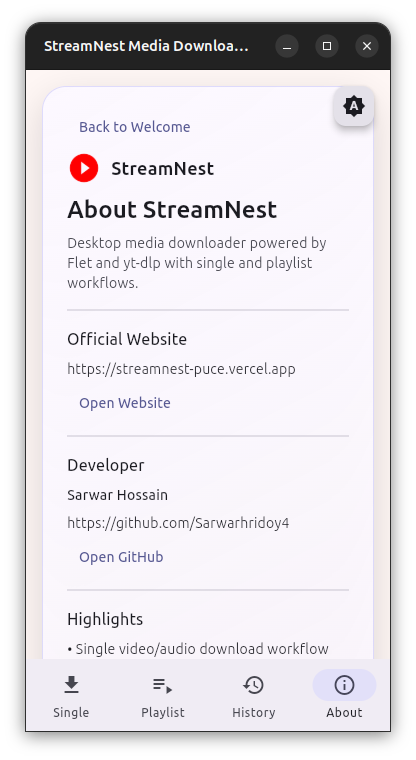

# StreamNest

StreamNest is a sleek, professional desktop media downloader built with **Flet** and **yt-dlp**. Featuring a modern indigo-themed UI with gradients and icons, it supports single media downloads and playlist workflows across providers supported by `yt-dlp`.

## Demo

Demo media removed to reduce build size.

## All Screenshots

### Welcome Screen



### Single Downloader



### Playlist Downloader



### Download History



### History Details



### About Section



### Additional Screenshots

#### FFmpeg Install Dialog



#### Download Progress



#### Download Complete



#### Playlist Selection



## Key Features

- Welcome-first entry flow with one-click launch into the app
- Centered card-based UI with bottom navigation tabs: **Single**, **Playlist**, **History**, **About**
- Back-to-welcome action available from all app cards
- Unified app branding with official play-circle icon assets
- Modern, professional design with indigo/purple theme and subtle gradients
- Device-theme aware styling:
  - Follows system theme by default
  - Live updates on platform brightness change (when supported)
  - Floating theme toggle button (System → Dark → Light → System)
- Enhanced UI elements with icons, improved typography, and polished buttons
- Startup FFmpeg detection with OS-specific install guidance in the UI
- One-click FFmpeg auto-install flow (Linux/macOS/Windows) with confirmation and privilege prompt support
- Live install/output log windows:
  - FFmpeg installer command output
  - `yt-dlp` runtime logs for active downloads
- Manual FFmpeg re-check action from the UI
- Dynamic format loading before download
- Download modes:
  - Video (MP4 remux)
  - Audio (MP3 extract)
- Playlist workflow:
  - Load playlist entries
  - Select specific items
  - Range support (`1-5`, `1,3,7-10`)
  - Playlist-specific quality and save folder
- Live progress information:
  - Progress bar
  - Speed and ETA
  - Current playlist file name
- Download result dialogs and encrypted local download history
- Recent downloads preview in the main interface

### Security

- URL validation blocks localhost, private IPs, embedded credentials, and dangerous schemes (file://, javascript:, data:)
- Path traversal protection for save directories (contained within home/$TMPDIR/Downloads)
- Download size capped at 5 GB per file
- Encrypted download history (Fernet, key file at 0o600 permissions, atomic writes)
- FFmpeg install command allowlisting and password validation


## Changelog

- See [Changelog](changelog.md) for release notes and ongoing updates.

## Requirements

- Python 3.11+
- FFmpeg (recommended for merge/remux/extract quality)
- uv (recommended package manager)

### Install uv

If `uv` is not installed, install it using one of the following methods:

**Using the official installer (Linux/macOS):**

```bash
curl -LsSf https://astral.sh/uv/install.sh | sh
```

**Using pip:**

```bash
pip install uv
```

**Using Homebrew (macOS):**

```bash
brew install uv
```

After installation, verify:

```bash
uv --version
```

## Installation

1. Clone the repository:

```bash
git clone git@github.com:Sarwarhridoy4/StreamNest.git
cd StreamNest
```

2. Create and activate a virtual environment:

```bash
uv venv
source .venv/bin/activate
```

Windows (PowerShell):

```powershell
uv venv
.venv\Scripts\Activate.ps1
```

3. Install dependencies:

```bash
uv pip install -e .
```

For detailed build, install, and usage instructions, see [INSTRUCTION.md](INSTRUCTION.md).

## FFmpeg Setup

- Automatic install from the app:
  - Click **Install FFmpeg** when prompted
  - Review command preview and confirm
  - Enter password (Linux privilege flow) when required
  - Track progress in **FFmpeg Install Log**
- Manual install:
  - Linux: install `ffmpeg` with your package manager
  - macOS: `brew install ffmpeg`
  - Windows: install FFmpeg and add it to `PATH` (or use Winget)

Verify:

```bash
ffmpeg -version
```

## Run

```bash
python main.py
```

## Usage

### Single Download

1. Paste a supported media URL (`http://` or `https://`).
2. Click **Load Formats**.
3. Select mode and quality.
4. Choose save folder (optional).
5. Click **Download**.

### Playlist Download

1. Open the **Playlist** tab.
2. Paste playlist URL.
3. Optional: enter range (`1-5`, `1,3,7-10`).
4. Click **Load Playlist**.
5. Select items.
6. Choose quality and save folder.
7. Click **Download Selected**.

### Advanced yt-dlp Engine Options

StreamNest exposes advanced yt-dlp options in the **yt-dlp engine** section of the left panel. These give fine-grained control over download behavior, output files, metadata, and network requests. They apply to both single and playlist downloads.

#### Playlist Controls

- **Reverse playlist order** — Download playlist items in reverse order (`--playlist-reverse`).
- **Random playlist order** — Download playlist items in random order (`--playlist-random`).

#### Output Control

- **No overwrites** — Skip files that already exist (`--no-overwrites`).
- **Force overwrites** — Replace existing files (`--force-overwrites`).
- **No `.part` files** — Write directly to the final filename instead of using `.part` temp files (`--no-part`).

#### Download Management

- **Max downloads** — Limit the number of items downloaded (`--max-downloads`). Enter a positive integer.
- **Socket timeout** — Fail fast on unresponsive hosts by setting a socket timeout in seconds (`--socket-timeout`). Enter a number (e.g. `30`).

#### Metadata & Sidecar Files

- **Write info JSON** — Save video metadata to a `.info.json` sidecar file (`--write-info-json`).
- **Write description** — Save the video description to a `.description` sidecar file (`--write-description`).
- **Write annotations** — Save annotations to a sidecar file (`--write-annotations`).
- **Add metadata** — Embed metadata into the downloaded media file (`--add-metadata`).

#### Subtitles & Chapters

- **Embed chapters** — Embed chapter markers into the output file (`--embed-chapters`).
- **Split by chapters** — Split the media into separate files at chapter boundaries (`--split-chapters`).

#### Network & Auth

- **User-Agent** — Send a custom User-Agent string (`--user-agent`). Enter a custom UA string.
- **Referer** — Send a custom Referer header (`--referer`). Enter a URL.

#### Engine Output

- **Verbose output** — Show detailed yt-dlp debug output in the yt-dlp log (`--verbose`).
- **No warnings** — Suppress yt-dlp warning messages (`--no-warnings`).

#### Geo

- **Geo bypass** — Bypass geographic restrictions (`--geo-bypass`).

> **Note:** Chapter-related options (embed-chapters, split-chapters) and metadata embedding require FFmpeg to be installed. See [FFmpeg Setup](#ffmpeg-setup).

### Welcome and Theme Behavior

1. App starts on the **Welcome** screen.
2. Click **Open StreamNest** to enter the tabbed app UI.
3. Use **Back to Welcome** to return to the welcome screen.
4. Theme follows your system setting by default.
5. Use the floating theme button (top-right) to cycle through System → Dark → Light themes.

## Development

### Testing

Install test dependencies:

```bash
uv pip install -e .[test]
```

Run tests:

```bash
pytest
```

### Linting and Type Checking

Install development dependencies:

```bash
uv pip install -e .[dev]
```

Lint with Ruff:

```bash
ruff check .
```

Type check with MyPy:

```bash
mypy .
```

### CI

This project uses GitHub Actions for continuous integration. The CI pipeline runs on push and pull requests, performing linting, type checking, and tests.

## Build Instructions

### Linux Packages (.deb + .AppImage)

For detailed Linux build instructions, see [LINUX_BUILD_INSTRUCTIONS.md](LINUX_BUILD_INSTRUCTIONS.md).

Brief overview:

Install prerequisites:

```bash
sudo apt update
sudo apt install clang cmake ninja-build pkg-config libgtk-3-dev desktop-file-utils dpkg-dev g++
```

Run packaging script:

```bash
./scripts/build_linux_packages.sh 2.0.2 amd64
```

### Android APK

Follow the official guide for environment setup (Java, Android SDK, Android command-line tools):

- https://docs.flet.dev/publish/android/

With this repo on the `android` branch:

1. Install dependencies:

```bash
uv pip install -e .
```

2. Build APK:

```bash
flet build apk
```

3. Optional release build:

```bash
flet build apk --release
```

Android packaging metadata is configured in `pyproject.toml` under `[tool.flet]` and `[tool.flet.android]`.

## Project Structure

```text
StreamNest/
├── main.py                     # App entry point and page bootstrapping
├── pyproject.toml              # Project configuration and dependencies
├── README.md                   # User documentation
├── INSTRUCTION.md              # Build, install, and usage instructions
├── SYSTEM_OVERVIEW.md          # System architecture and design
├── changelog.md                # Project change history
├── LICENSE                     # MIT license
├── .github/
│   └── workflows/
│       └── ci.yml              # GitHub Actions CI configuration
├── .gitignore                  # Git ignore patterns
├── assets/                     # Icons, demo media, screenshots
├── services/
│   ├── downloader.py           # yt-dlp orchestration, hooks, progress
│   └── format_extractor.py     # Format and playlist metadata extraction
├── state/
│   └── app_state.py            # Shared UI state model
├── tests/                      # Unit and integration tests
│   ├── __init__.py
│   ├── test_ffmpeg_utils.py    # Tests for FFmpeg utilities
│   └── test_ffmpeg_install_mixin.py  # Tests for FFmpeg install mixin
├── ui/
│   ├── components.py           # Reusable UI helpers
│   ├── home_view.py            # Compatibility wrapper exporting HomeView
│   └── home/                   # Modular HomeView implementation
│       ├── home_view.py        # Core HomeView shell/state and shared handlers
│       ├── control_layout_mixin.py
│       ├── view_layout_mixin.py
│       ├── download_mixin.py
│       ├── playlist_mixin.py
│       ├── history_mixin.py
│       └── ffmpeg_install_mixin.py
└── utils/
    ├── file_manager.py         # Directory helpers + size/speed/eta formatters + path traversal protection
    ├── history_store.py        # Fernet-encrypted download history persistence
    └── validators.py           # URL and input validation helpers
```

## Troubleshooting

### Progress updates seem delayed

- Ensure dependencies are installed in the active virtual environment.
- Check terminal output for runtime exceptions.

### History storage fails with permission errors

- If you installed StreamNest as a `.deb` or AppImage, the app no longer stores history inside the installation directory.
- History is saved under the XDG state directory by default (`$XDG_STATE_HOME/streamnest` or `~/.local/state/streamnest`).
- If that location is unavailable, the app transparently falls back to `$TMPDIR/streamnest`.

### Speed/ETA missing on some media

- Some providers/streams do not expose stable throughput metrics.
- Keep `yt-dlp` and FFmpeg updated.

### Post-processing errors

- Confirm `ffmpeg` is available in `PATH`.
- Verify with `ffmpeg -version`.

### Linux build fails with `Failed to find any of [ld.lld, ld]`

- Install linker toolchain for LLVM 20: `sudo apt install lld-20`
- Verify binary exists: `/usr/lib/llvm-20/bin/ld.lld`
- Re-run: `./scripts/build_linux_packages.sh 2.0.2 amd64`

## Developer

- Official Website: [streamnest-puce.vercel.app](https://streamnest-puce.vercel.app)
- Name: Sarwar Hossain
- GitHub: [Sarwarhridoy4](https://github.com/Sarwarhridoy4)

## License

This project is licensed under the MIT License. See `LICENSE`.

## Disclaimer

Use this software lawfully and in compliance with platform terms, copyright, and local regulations.
