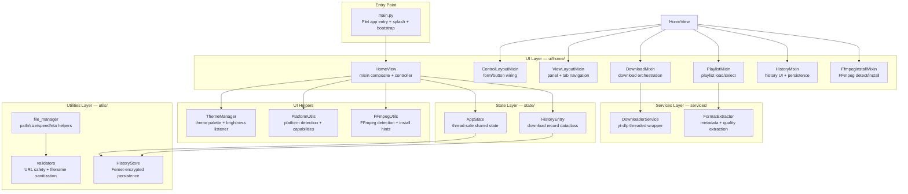
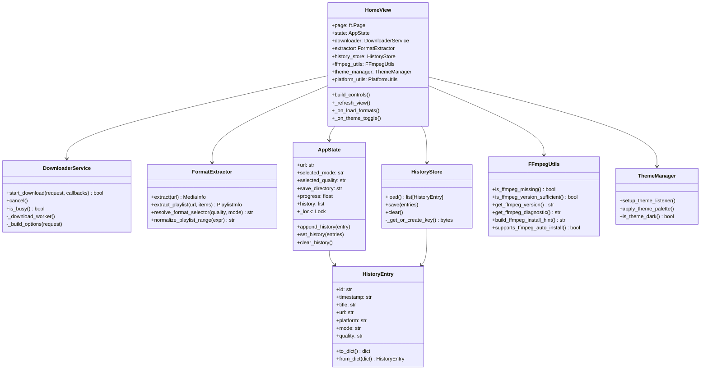
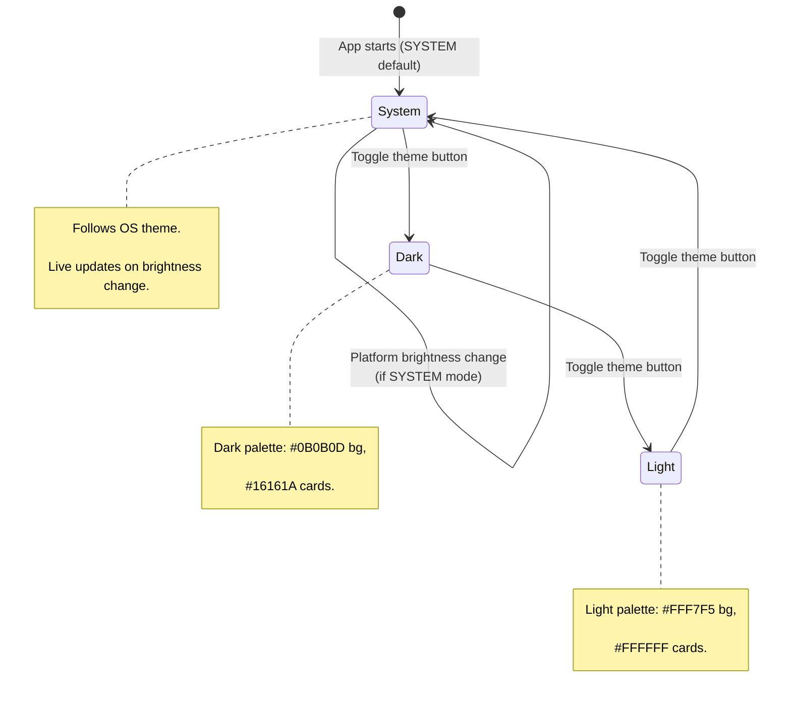
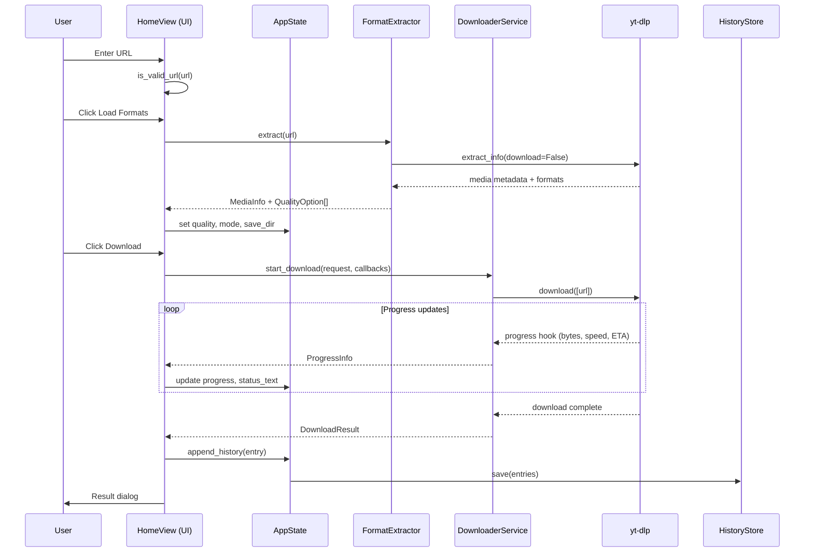
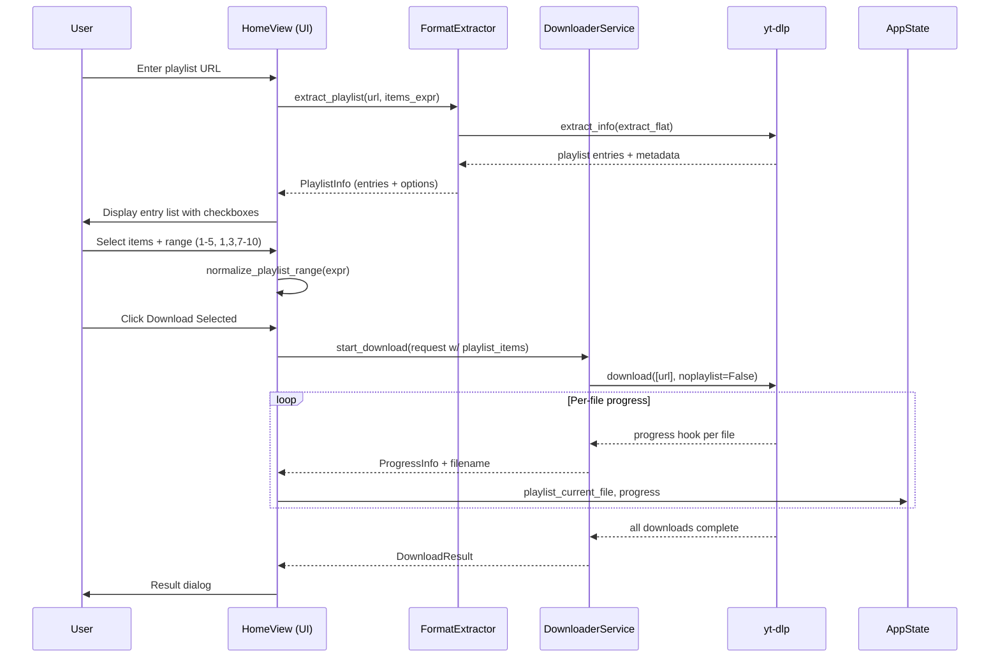
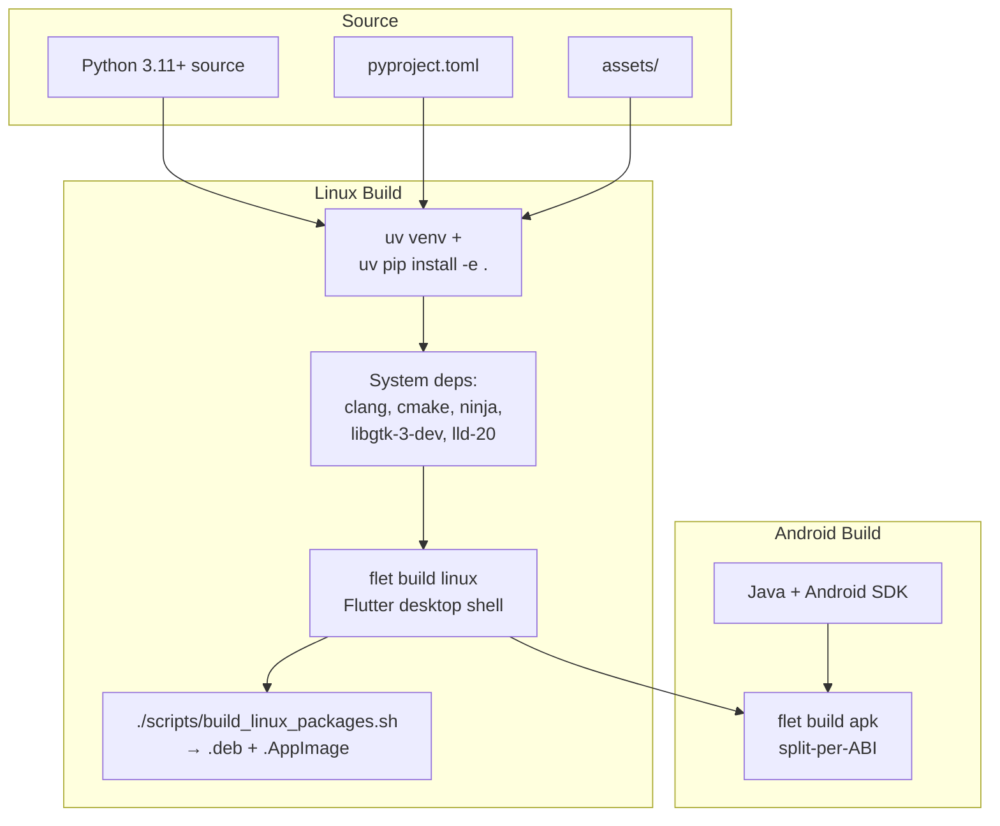

# System Overview — StreamNest

**StreamNest** is a cross-platform desktop media downloader built with **Flet** (Python) and **yt-dlp**. It provides a modern, indigo-themed GUI for downloading single media items and playlists from any provider supported by `yt-dlp`, with features including quality selection, audio extraction, playlist range selection, live progress tracking, FFmpeg auto-installation, and encrypted local download history.

---

## 1. Purpose and Scope

StreamNest addresses the need for a polished, desktop-first media downloader with:

- Single-video and playlist download workflows
- Dynamic quality/format discovery before download
- Audio (MP3) extraction via FFmpeg
- Playlist item selection with range expressions (`1-5`, `1,3,7-10`)
- Live progress, speed, and ETA reporting
- Startup FFmpeg detection with OS-specific auto-install guidance
- Encrypted, persistent download history (XDG-compliant storage)
- System/Dark/Light theme support with live platform-brightness tracking
- Desktop (Linux/macOS/Windows), Android APK, and Linux `.deb`/`.AppImage` packaging

**Out of scope:** backend server, user accounts, cloud synchronization, DRM-protected content, or anything violating platform terms/copyright law.

---

## 2. High-Level Architecture

StreamNest follows a **layered, mixin-based GUI architecture**:



**Key architectural principles:**

- **Separation of concerns:** UI (Flet), business logic (services), state (dataclasses + Lock), utilities (file/history/validation).
- **Thread safety:** `AppState` uses a `threading.Lock`; `DownloaderService` runs yt-dlp in a daemon thread with a cancel `Event` and active-download lock to prevent concurrent downloads.
- **Mixin composition:** `HomeView` composes behavior via mixins, keeping each concern isolated and testable.
- **Defensive URL validation:** `is_valid_url` rejects `localhost`, `.local`, private/loopback/link-local/reserved IPs, and credentials in URLs.

---

## 3. Component Catalog

### 3.1 Entry Point — `main.py`

- `main(page)` — configures the Flet page (title, indigo theme seed `#6366f1`, SYSTEM theme mode, minimum window size on desktop), shows an animated splash screen, then asynchronously bootstraps `HomeView`.
- `create_splash_screen()` — returns a pulsed logo container and an animation starter.
- `initialize_app_async(page)` — builds `HomeView`, replaces the splash, and renders an error fallback on failure.

### 3.2 UI Layer — `ui/`

| File | Responsibility |
|------|----------------|
| `ui/components.py` | Shared UI primitives: header, labeled controls, status chips, primary/secondary buttons with indigo theme colors (`#6366f1`, `#8b5cf6`, `#4f46e5`, `#7c3aed`). |
| `ui/home_view.py` | Compatibility wrapper re-exporting `HomeView` from `ui/home/home_view.py`. |
| `ui/home/home_view.py` | Core `HomeView` composite: initializes state, services, theme, FFmpeg; owns all event handlers (URL commit, load formats, mode/quality change, directory pick, theme toggle, tab navigation, back-to-welcome, result dialogs). |
| `ui/home/control_layout_mixin.py` | Builds and wires form controls (URL field, mode group, quality dropdown, save dir, buttons). |
| `ui/home/view_layout_mixin.py` | Builds panels (welcome, single, playlist, history, about) and the bottom navigation tab host. |
| `ui/home/download_mixin.py` | Download execution handlers: start/cancel, progress callbacks, result dialogs, yt-dlp log display. |
| `ui/home/playlist_mixin.py` | Playlist load, item selection, range parsing, playlist download orchestration. |
| `ui/home/history_mixin.py` | History rendering, entry detail modal, erase-with-confirmation. |
| `ui/home/ffmpeg_install_mixin.py` | FFmpeg install/re-check UI flow: confirmation dialog, privilege prompt, live install log. |
| `ui/home/theme_manager.py` | `ThemeManager`: applies dark/light palette, card/input styling, platform brightness listener. |
| `ui/home/platform_utils.py` | `PlatformUtils`: platform detection (Android/iOS/desktop), directory-picker and open-folder capability checks. |
| `ui/home/ffmpeg_utils.py` | `FFmpegUtils` + `FFmpegVersion`: `ffmpeg -version` detection, minimum version enforcement (4.0.0), diagnostics, platform-specific install hints, auto-install support check. |

### 3.3 Services Layer — `services/`

| File | Responsibility |
|------|----------------|
| `services/downloader.py` | `DownloaderService`: threaded yt-dlp wrapper. `DownloadRequest`/`ProgressInfo`/`DownloadResult` dataclasses. Progress/speed/ETA calculation from yt-dlp hooks, cancel support via `DownloadCancelledError`, post-processor hooks, FFmpeg location injection, format selector resolution. |
| `services/format_extractor.py` | `FormatExtractor`: extracts media metadata and quality options via yt-dlp (`extract_info`, `download=False`). `MediaInfo`, `PlaylistInfo`, `PlaylistEntry`, `QualityOption` dataclasses. `resolve_format_selector()` maps UI quality to yt-dlp format strings. `normalize_playlist_range()` validates/normalizes range expressions. |

### 3.4 State Layer — `state/`

| File | Responsibility |
|------|----------------|
| `state/app_state.py` | `AppState`: thread-safe shared UI state (URL, mode, quality, directories, progress, status, history). `HistoryEntry` dataclass with `to_dict`/`from_dict` serialization. History capped at 50 entries. |

### 3.5 Utilities Layer — `utils/`

| File | Responsibility |
|------|----------------|
| `utils/history_store.py` | `HistoryStore`: Fernet-encrypted (`cryptography`) persistent download history. Primary location: XDG state dir (`$XDG_STATE_HOME/streamnest` or `~/.local/state/streamnest`); transparent fallback to `$TMPDIR/streamnest`. Key stored at `.history.key` (mode `0o600`), overridable via `STREAMNEST_HISTORY_KEY` env var. |
| `utils/file_manager.py` | `resolve_download_directory`, `ensure_download_directory`, `format_bytes`, `format_speed`, `format_eta`. Fallback to `~/Downloads` on OSError. |
| `utils/validators.py` | `is_valid_url` (HTTP(S) only, no localhost/private IPs, no credentials, max 2048 chars), `sanitize_filename_component`. |

### 3.6 Configuration — `pyproject.toml`



- Project: `streamnest`, version `2.0.2`, Python `>=3.11`.
- Runtime deps: `flet[all]>=0.82.0,<2.0.0`, `yt-dlp>=2026.3.10,<2027.0.0`, `cryptography>=45.0.0,<51.0.0`.
- Optional: `test` (pytest, pytest-mock), `dev` (ruff, mypy).
- Ruff: line-length 120, py311, extensive rule set (see `pyproject.toml`).
- MyPy: strict settings (`disallow_untyped_defs`, `warn_return_any`, `strict_equality`, etc.).
- Flet: org `com.sarwarhridoy4`, product `StreamNest`, entry `main:main`; Android permissions for internet/storage/media; split-per-ABI APKs.
- Packaging: `ui*`, `state*`, `services*` packages included; `assets*` excluded.

### 3.7 Theme State Machine



---

## 4. Data Flow

### 4.1 Single Download Flow



### 4.2 Playlist Download Flow



### 4.3 FFmpeg Detection & Install Flow

```mermaid
flowchart TD
    Start([Startup]) --> Detect{FFmpegUtils.<br/>is_ffmpeg_missing()}
    
    Detect -->|Missing| ShowWarning[Show red warning<br/>Offer Install FFmpeg button]
    Detect -->|Found| ShowVersion[Show green: FFmpeg {version}<br/>detected]
    
    ShowVersion --> End1[Ready]
    
    ShowWarning --> ClickInstall{User clicks<br/>Install FFmpeg?}
    
    ClickInstall -->|No| End2[Continue without FFmpeg<br/>merge/extract disabled]
    
    ClickInstall -->|Yes| Confirm[Confirmation dialog<br/>+ privilege prompt Linux]
    Confirm --> InstallPlan[Build OS-specific install command<br/>Linux: apt / macOS: brew / Windows: winget]
    InstallPlan --> InstallLog[Run subprocess install<br/>stream output to FFmpeg Install Log]
    InstallLog --> Recheck{Installation<br/>successful?}
    
    Recheck -->|Yes| RecheckUI[Show FFmpeg {version} detected<br/>hide install button]
    Recheck -->|No| InstallFail[Show install failure hint]
    
    RecheckUI --> End3[Merge/extract enabled]
    InstallFail --> End4[Manual install required]
    
    style Start fill:#e1f5fe
    style ShowVersion fill:#c8e6c9
    style ShowWarning fill:#ffcdd2
    style End3 fill:#c8e6c9
    style End4 fill:#ffcdd2
```

### 4.4 History Persistence Flow

```mermaid
flowchart TD
    Complete([Download completes]) --> CreateEntry[Create HistoryEntry<br/>id, timestamp, title, url, platform,<br/>mode, quality, save_directory, context,<br/>status, message]
    
    CreateEntry --> Append[AppState.append_history(entry)<br/>lock-protected, cap at 50]
    
    Append --> Save[HistoryStore.save(entries)<br/>Fernet-encrypt JSON payload]
    
    Save --> XDG{Write to XDG state dir?<br/>$XDG_STATE_HOME/streamnest}
    
    XDG -->|Yes| XDGWrite[Write download_history.enc +<br/>.history.key (0o600)]
    XDG -->|No| Fallback[Fallback to $TMPDIR/streamnest]
    
    Fallback --> FBWrite[Write encrypted history to<br/>temporary directory]
    
    XDGWrite --> End[History persisted]
    FBWrite --> End
    
    subgraph Startup
        Direction TB
        Load[App startup] --> LoadHistory[HistoryStore.load()<br/>decrypt + repopulate AppState.history]
    end
    
    style Complete fill:#e1f5fe
    style Save fill:#fff3e0
    style XDGWrite fill:#c8e6c9
    style FBWrite fill:#fff3e0
    style LoadHistory fill:#e3f2fd
```

---

## 5. Technology Stack

| Layer | Technology | Version / Constraint |
|-------|-----------|---------------------|
| Language | Python | 3.11+ |
| GUI Framework | Flet | `>=0.82.0,<2.0.0` |
| Download Engine | yt-dlp | `>=2026.3.10,<2027.0.0` |
| Encryption | cryptography (Fernet) | `>=45.0.0,<51.0.0` |
| Linting | Ruff | `>=0.1.0` |
| Type Checking | MyPy | `>=1.0.0` |
| Testing | pytest, pytest-mock | `>=7.0.0`, `>=3.0.0` |
| Packaging (Linux) | Flet build + CMake + appimagetool | `.deb` + `.AppImage` |
| Packaging (Android) | Flet CLI | APK (split-per-ABI) |

---

## 6. Build & Distribution

| Target | Method | Details |
|--------|--------|---------|
| Linux desktop (source) | `python main.py` | Requires Python 3.11+, FFmpeg optional |
| Linux `.deb` + `.AppImage` | `./scripts/build_linux_packages.sh <version> <arch>` | Needs `clang`, `cmake`, `ninja-build`, `pkg-config`, `libgtk-3-dev`, `lld-20` |
| Linux executable | `flet build linux` | Flutter desktop shell; output in `build/linux/` |
| Android APK | `flet build apk` (on `android` branch) | Requires Java + Android SDK; permissions in `pyproject.toml` |

See `LINUX_BUILD_INSTRUCTIONS.md` for detailed Linux build steps and troubleshooting.



---

## 7. CI/CD

GitHub Actions workflow (`.github/workflows/ci.yml`) runs on push/PR to `production`:

1. Set up Python 3.11 + cache `uv` dependencies.
2. Install `uv pip install -e .[test,dev]`.
3. `ruff check .` — linting.
4. `mypy .` — type checking.
5. `pytest` — unit/integration tests.

Tests live in `tests/`: `test_ffmpeg_utils.py` and `test_ffmpeg_install_mixin.py`.

---

## 8. Security Considerations

- **URL validation** blocks `localhost`, `.local`, private/loopback/link-local/reserved/multicast IP addresses, embedded credentials (`@` in URL), data URIs, `javascript:` schemes, `file://` paths, and path-traversal fragments (`..`, `/etc/`, `/proc/`, etc.). Hostname length is capped at 253 chars (RFC 1035); dangerous ports (20–27017 range) are rejected.
- **Path traversal protection**: User-provided save directories are resolved and checked against allowed roots (home directory, `$TMPDIR`, `~/Downloads`). Paths escaping these roots are redirected to a safe fallback. Download size is capped at 5 GB per file to prevent disk exhaustion.
- **Filename sanitization** strips reserved characters (`\ / : * ? " < > |`) from path components and collapses repeated underscores.
- **Encrypted history** uses Fernet (AES-128 in CBC mode with HMAC) with a key file (`0o600` permissions, enforced on every read/write) or `STREAMNEST_HISTORY_KEY` env var. History files are written atomically via temp-file + `os.replace()`. Key file permissions are verified and corrected to `0o600` on access.
- **Privilege handling** for Linux FFmpeg install prompts for a password via the UI install flow. Passwords are validated for length (max 256 chars) and control characters before being passed to `sudo -S`. Install commands use subprocess list form (no `shell=True`); command binaries are allowlisted (`winget`, `brew`, `apt-get`, `dnf`, `yum`, `pacman`, `zypper`, `sudo`) before execution.
- No secrets or keys are committed; `.history.key` and `download_history.enc` are gitignored.


---

## 9. Directory Layout

```
StreamNest/
├── main.py                     # Flet entry point + splash + app bootstrap
├── pyproject.toml              # Project config, deps, ruff/mypy/flet settings
├── uv.lock                     # Locked dependency tree
├── README.md                   # User documentation
├── SYSTEM_OVERVIEW.md          # This document
├── changelog.md                # Release notes
├── LICENSE                     # MIT
├── .gitignore
├── .github/
│   └── workflows/
│       └── ci.yml              # GitHub Actions CI
├── scripts/
│   └── build_linux_packages.sh # Linux .deb + .AppImage packaging
├── assets/
│   ├── icon.png                # App logo
│   ├── icon-64/128/256/512.png # Launcher icons
│   ├── demo/                   # Demo video + preview gif
│   └── screenshots/            # UI screenshots
├── services/
│   ├── __init__.py
│   ├── downloader.py           # yt-dlp threaded wrapper (DownloaderService)
│   └── format_extractor.py     # Metadata + quality extraction (FormatExtractor)
├── state/
│   ├── __init__.py
│   └── app_state.py            # AppState + HistoryEntry (thread-safe)
├── tests/
│   ├── __init__.py
│   ├── test_ffmpeg_utils.py
│   └── test_ffmpeg_install_mixin.py
├── ui/
│   ├── __init__.py
│   ├── components.py           # Reusable UI helpers + theme colors
│   ├── home_view.py            # Compatibility wrapper
│   └── home/
│       ├── __init__.py
│       ├── home_view.py        # HomeView (mixin composite)
│       ├── control_layout_mixin.py
│       ├── view_layout_mixin.py
│       ├── download_mixin.py
│       ├── playlist_mixin.py
│       ├── history_mixin.py
│       ├── ffmpeg_install_mixin.py
│       ├── ffmpeg_utils.py     # FFmpegUtils + FFmpegVersion
│       ├── platform_utils.py   # PlatformUtils
│       └── theme_manager.py    # ThemeManager
└── utils/
    ├── __init__.py
    ├── file_manager.py         # Path/size/speed/eta helpers
    ├── history_store.py        # Fernet-encrypted history persistence
    └── validators.py           # URL validation + filename sanitization
```

---

## 10. Developer Contacts

- **Author:** Sarwar Hossain
- **GitHub:** [Sarwarhridoy4](https://github.com/Sarwarhridoy4)
- **Website:** [streamnest-puce.vercel.app](https://streamnest-puce.vercel.app)
- **License:** MIT

---

**Disclaimer:** Use this software lawfully and in compliance with platform terms, copyright, and local regulations.
